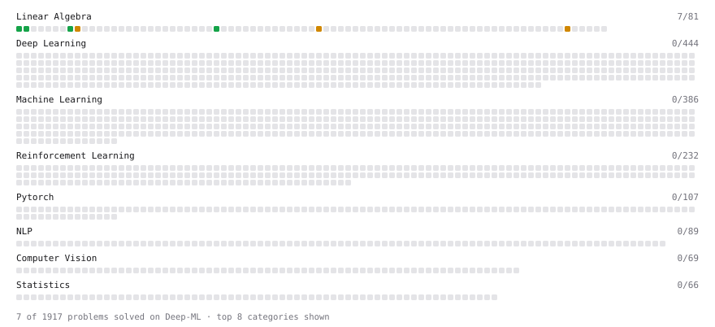

# Deep-ML

My machine learning practice from [Deep-ML](https://www.deep-ml.com). Every solution here was written by hand.

**10** solved · 7 problems · 0 labs · 3 math

[**Browse the interactive portfolio**](https://SCRCCO.github.io/deep-ml/) to replay this filling in over time.

## Problems

| | Difficulty | Solved | |
| --- | --- | --- | --- |
| [Calculate 2x2 Matrix Inverse](https://www.deep-ml.com/problems/8) | easy | 2026-11-03 | [solution](problems/0008-calculate-2x2-matrix-inverse) |
| [Dot Product Calculator](https://www.deep-ml.com/problems/83) | easy | 2026-11-02 | [solution](problems/0083-dot-product-calculator) |
| [Matrix-Vector Dot Product](https://www.deep-ml.com/problems/1) | easy | 2026-11-02 | [solution](problems/0001-matrix-vector-dot-product) |
| [Transpose of a Matrix](https://www.deep-ml.com/problems/2) | easy | 2026-11-02 | [solution](problems/0002-transpose-of-a-matrix) |
| [Cholesky Decomposition](https://www.deep-ml.com/problems/334) | medium | 2026-11-06 | [solution](problems/0334-cholesky-decomposition) |
| [Matrix times Matrix ](https://www.deep-ml.com/problems/9) | medium | 2026-11-02 | [solution](problems/0009-matrix-times-matrix) |
| [Woodbury, Sherman-Morrison and the Determinant Lemma](https://www.deep-ml.com/problems/1774) | medium | 2026-11-03 | [solution](problems/1774-woodbury-sherman-morrison-and-the-determinant-lemma) |

## Math

| | Difficulty | Solved | |
| --- | --- | --- | --- |
| [Condition Numbers: Why the Determinant Lies About Near-Singularity](https://www.deep-ml.com/math-problems/412) | medium | 2026-11-05 | [solution](math/0412-condition-numbers-why-the-determinant-lies-about-near-singularity) |
| [Schur Complements and the Partitioned Inverse](https://www.deep-ml.com/math-problems/409) | medium | 2026-11-03 | [solution](math/0409-schur-complements-and-the-partitioned-inverse) |
| [Woodbury, Sherman-Morrison and the Matrix Determinant Lemma](https://www.deep-ml.com/math-problems/410) | medium | 2026-11-03 | [solution](math/0410-woodbury-sherman-morrison-and-the-matrix-determinant-lemma) |

---

_This file is regenerated by Deep-ML on every push._
